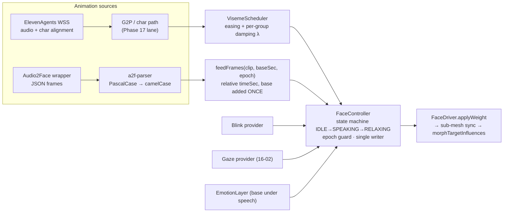

# The Animation Runtime — One Face, Two Engines

> Working draft (16-DRAFT). Destination: `docs/animation-runtime.md` after Phase 12
> (English-ization); linked from README by Phase 13. Audience: a technical reviewer
> reading the repo — this is the part worth reading.

## The problem it solves

A talking avatar needs its mouth to agree with its audio — for two very different
kinds of animation data. LIVE conversation produces **char alignments** (when each
character is audible) that we convert to visemes and smooth ourselves. NVIDIA
Audio2Face produces **absolute blendshape frames** (52 ARKit weights per frame, 30–60
fps) whose micro-mimicry would be destroyed by smoothing designed for sparse visemes.
One face, two engines, and one rule that keeps them sane: **a single writer, a shared
epoch, and per-source smoothing.**

## Architecture

## The three invariants

1. **Single writer.** Only FaceController writes face morphs. Every procedural layer
   (blink, gaze, emotion) is a *provider* that hands values in; the driver's own relax
   loop was deleted precisely because it was a second writer. Bone regions have their
   own owners (eyeballs: GazeSaccades; head/chest: micro-movements) — the seam the
   future AvatarDirector extends.
2. **Epoch-based barge-in.** Every interruption bumps an epoch. Scheduled audio, queued
   visemes and buffered frames all carry the epoch they were born with; stale data is
   dropped at the gate, not cancelled by racing timeouts. Result: audio stops in <50 ms
   and the face relaxes to neutral in <300 ms — with no orphaned chunks, ever.
3. **Per-source smoothing.** The viseme scheduler smooths (blend-in/hold/blend-out,
   per-muscle-group λ: closures ×1.7, jaw ×1.55, smile ×0.45 — consonants must be
   snappier than smiles). The frames track is a strict passthrough — zero-order hold,
   no damping — because A2F's value IS its micro-mimicry. Shared: state machine, epoch,
   safety clamps (mouthClose ≤ 0.85, driver-level 0..1).

## State machine

`IDLE → SPEAKING → RELAXING → IDLE`, with a full transition×event contract (23 cells,
each tested — see `tests/face-controller-transitions.test.ts`). Interruption is
idempotent: IDLE stays IDLE (a deferred mode switch still commits), RELAXING re-anchors
its timer, SPEAKING clears both queues and relaxes. Mode switches requested mid-turn
defer to the turn boundary — the face never pops.

## Timebase discipline

One clock per concern, no cross-clock arithmetic: **AudioContext.currentTime** owns
speech, frames and blinks (the audio axis is the truth — that's what lips must match);
an **injectable wall clock** owns RELAXING (a UI-time ease, not an audio event); the
**rAF timestamp** owns gaze scheduling and FPS windows. Damping is `1-exp(-λ·dt)` —
frame-rate independent by construction.

## Performance posture

The SPEAKING hot path is allocation-free by construction: scratch Maps reused, queue
compaction in place, no closures per frame. An opt-in allocation probe
(`allocProbe`) counts would-be allocations; a test asserts zero across 120 rendered
frames in both tracks. All tuning constants live in one typed, frozen module
(`anim-config.ts`) — 28 magic-number groups consolidated, six safety numbers
snapshot-tested so every change is a conscious one.

## Extension points

- **New source**: register through `registerTrackSource(id, adapter)` — the source
  declares `kind: 'viseme' | 'frames'` (`FaceTrackSource`: `start` / `feed` / `stop`, driven through `startTrack` / `feedTrack` / `stopTrack`) and gets the same state machine, epoch and
  safety for free. A test registers a synthetic third source end-to-end without
  touching FaceController internals.
- **New region** (AvatarDirector): the region-ownership map (face/bones/head → owners)
  is documented at the source registry; a body region adds its own owner, never a
  second writer to the face.
- **Per-turn policy**: `resolveAnimationSource` is the single policy point — today
  LIVE turns always resolve to the viseme track; streaming A2F (future) changes the
  policy, not the engine.

## Where to look in the code

| Concern | File |
|---|---|
| State machine, epoch, layer order | `src/lipsync/face-controller.ts` |
| Viseme smoothing (λ, easing, clamps) | `src/lipsync/viseme-scheduler.ts` |
| All tuning constants | `src/lipsync/anim-config.ts` |
| A2F frames contract (PascalCase→camelCase, carriesEyes) | `src/lipsync/a2f-parser.ts` |
| Source registry + AvatarDirector seam | `src/lipsync/animation-sources.ts` |
| Per-turn policy | `src/lipsync/animation-router.ts` |
| Tests: matrix / races / clocks / allocations | `tests/face-controller-*.test.ts`, `tests/race-condition-epoch.test.ts`, `tests/hot-path-allocations.test.ts` |
