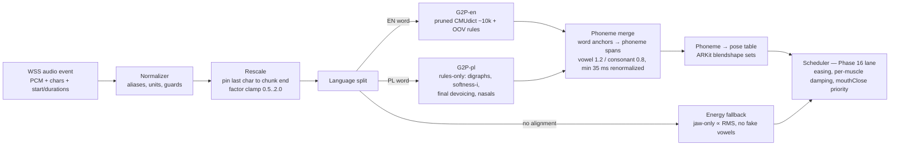

# How Lip-Sync Works — Alignment, Phonemes, Visemes

> Working draft (17-DRAFT). Destination: `docs/lipsync-deep-dive.md` after Phase 12;
> linked from README's "How lip-sync works" section (Phase 13). Audience: a technical
> reviewer — this is the core IP of the project.

## The insight: don't guess phonemes — you already have them

Most browser lip-sync either (a) analyzes audio acoustics and guesses vowels, or (b)
plays canned mouth frames. This project does neither: **ElevenAgents streams character
alignments with every audio chunk** — the exact character, its start time and duration,
in the same event as the PCM. We know *what* is being said and *when*, so the only real
problem is mapping orthography to mouth poses. That is a data problem, and data problems
can be measured, tested, and regression-pinned.

## The pipeline

## Layer by layer

**Normalization.** The wire format is defensive: three field aliases, two unit systems,
length guards. Malformed alignment never crashes — it degrades to fallback. (Pure
function, fully unit-tested.)

**Rescale.** Text span ≠ chunk audio length (observed ratios 0.56–2.5×). Without
correction, error accumulates chunk-over-chunk into visible drift. A per-chunk linear
factor pins the last character to the chunk's end; proportions inside survive.

**G2P, English.** A *pruned* CMU lexicon (~10k conversational words, chosen by measuring
≥95% hit-rate on a committed corpus) generated at build time by a committed script —
because a 961 kB dictionary chunk for a talking head is a smell, and conversational
English is brutally Zipfian. Out-of-vocabulary words fall to letter rules hardened for
exactly the classes that motivated them: silent letters (`island`, `listen`) and
`-tion/-sion`. The fallback ladder is total: lexicon → apostrophe/hyphen variants →
rules → char table — a word never reaches "nothing".

**G2P, Polish.** Polish orthography is nearly phonemic, so PL needs no lexicon at all:
deterministic rules (digraphs sz/cz/rz/ch, softness-i consumed into the preceding
consonant — `ziarno` [ʑ] vs `zima` [z+i] — final devoicing, nasal vowels) beat the
legacy 1-char-window char table. The char table survives as the ultimate fallback.

**Merge.** Word boundaries come from the alignment; phoneme durations inside a word are
proportional (vowels 1.2 / consonants 0.8) with a 35 ms floor — **renormalized to the
word's time window**, so spans can never bleed into the next word. Silent letters don't
exist as phonemes, so their time is absorbed by construction.

**Pose table.** ARPAbet/PL-class → ARKit blendshape sets with twin differentiation
(S vs SH: teeth; O vs U: rounding depth), v1.3 "nuances" (upper-lip raise on IY/EY,
lower-lip on open vowels), and diphthong motion (AY, AW split into start+end spans).
Effective values are layered: table × articulation preset × 0.85 mouthClose cap — a
computed test guarantees M/B/P closures reach ≥0.85 effective on the balanced profile.

**Fallback.** When alignment is absent, the avatar moves ONLY the jaw, driven by RMS
energy per 70 ms window — no fake vowels (a phase-7 lesson: a flapping jaw is honest,
an invented "O" is a lie). The UI shows a degradation chip; telemetry badges the source
(EL ✓ / fallback ⚠) per chunk.

## The neural alternative (and why it's a second track, not a replacement)

NVIDIA Audio2Face produces absolute 52-blendshape frames — micro-mimicry our scheduler
would destroy with smoothing designed for sparse visemes. So it runs as a separate
track (frames mode, strict passthrough) under the same state machine, epoch and safety
clamps (see the animation-runtime deep-dive). The A/B compare UI replays the SAME
PCM through both tracks. Acoustic guessing (Rhubarb/MFCC) stays deliberately deferred:
we know the phonemes — guessing them would be strictly worse — revisit triggers
documented (non-phonetic-alignment languages, or a need for an independent quality
signal).

## How it's proven

- **Golden-span fixtures**: committed corpus (control sentences + conversational
  paragraphs) with expected phoneme sequences and span-sum tolerances — merge and G2P
  regressions are caught in `npm test`, not in a demo.
- **Computed quality proxies**: closure presence (M/B/P effective mouthClose ≥ 0.85),
  per-viseme distinctness (min pairwise L1 distance between pose vectors) — numbers,
  not eyeballs.
- **Scripted live UAT**: a repeatable protocol (closures, silent letters, twins, PL
  digraphs, 30 s drift, 10× barge-in) whose filled results table lives in the phase
  verification file.

## Where to look

| Concern | File |
|---|---|
| Alignment normalization + rescale | `src/audio/alignment-normalize.ts`, `src/audio/alignment-rescale.ts` |
| EN G2P + pruned lexicon build | `src/lipsync/g2p/g2p-en.ts`, `scripts/build-dict-en.mjs` |
| PL rules | `src/lipsync/g2p/g2p-pl.ts` |
| Timing merge | `src/lipsync/g2p/phoneme-merge.ts` |
| Pose tables | `src/lipsync/g2p/phoneme-visemes.ts` |
| Fallback | `src/audio/energy-fallback.ts` |
| Corpus + golden spans | `tests/fixtures/lipsync-corpus.json` |
