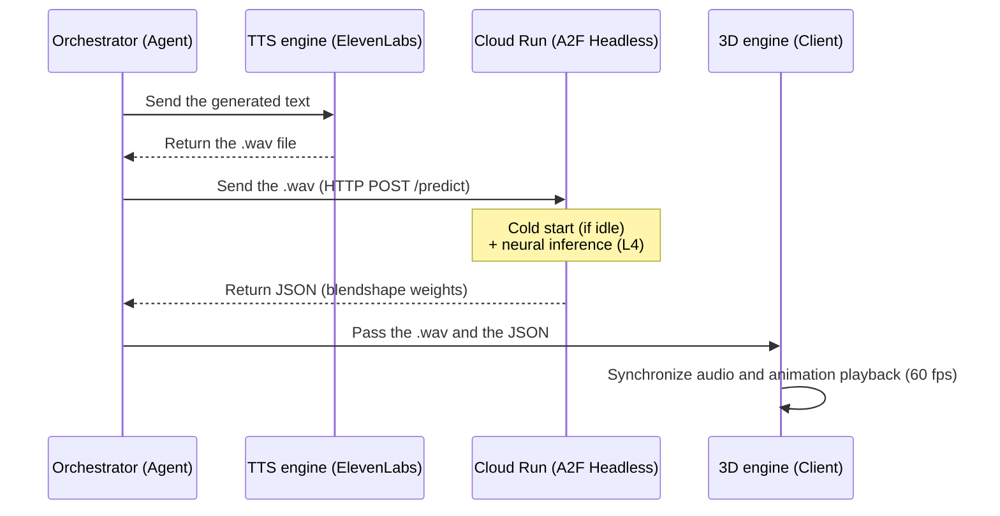

# 7. Alternative: Neural Audio-to-Face — NVIDIA Audio2Face on Google Cloud Run (Serverless GPU)

> **Status:** research / an alternative to the current viseme lip-sync (docs/3).
> **Goal:** realistic micro-expressions that react to voice and emotion, instead of rigid viseme mapping.
> **Context:** the current system (docs/1–6) animates the mouth from the ElevenLabs character alignment + the G2P layer + the Viseme Editor. The document below describes how to replace the face layer with **neural NVIDIA Audio2Face (A2F)**, deployed cost-effectively on **Google Cloud Run with L4 accelerators**.

## 1. Architectural rationale

The current viseme system, although lightweight, has limitations in realism, micro-expressions and reaction to the emotional charge of the voice. Replacing it with a **Neural Audio-to-Face** architecture eliminates these problems.

Choosing **Google Cloud Run with GPU (Scale-to-Zero)** allows:

- **Cost optimization** — the app runs and incurs costs (about $0.67/h of L4 accelerator time) only while it is actually performing inference on an audio file;
- **no operations overhead** — no need to manage virtual machines (Compute Engine);
- **ease of integration** — packaging A2F in a container (NVIDIA NIM / headless) lets this step be embedded as a single tool in wider, multi-agent developer environments.

## 2. Pipeline architecture

The solution is based on microservices. The whole can be managed by a main orchestrator process (e.g., a sub-agent) that handles the asynchronous calls.

### Components

1. **Brain (LLM agent)** — generates the response text and emotional/contextual tags.
2. **Voice (TTS engine)** — e.g., the ElevenLabs API; converts the text into a `.wav` file (PCM, 16–44.1 kHz).
3. **Facial-expression server (Cloud Run + L4)** — a containerized instance of Audio2Face in headless mode (images from NVIDIA NGC). Receives the `.wav` over REST, runs inference, and returns JSON with the weights of 52 ARKit blendshapes per frame.
4. **Client (3D engine / UI)** — the end application; fetches the audio + JSON and plays the sound and animation in sync (Unreal / Unity / **WebGL — our case**).

## 3. Flow diagram (sequence)



## 4. Deployment challenges and mitigation

### A. Cold starts

The biggest challenge of Cloud Run is the wake-up time. Docker images with NVIDIA models can weigh several to a dozen-plus GB; the first request to a sleeping server can take tens of seconds.

* **Mitigation:** asynchronous mechanisms on the front end (waiting animations, response buffering); optionally `min instances = 1` during peak hours.

### B. Cloud Run time limits

A single request has a maximum timeout (up to ~60 min). For short clips (assistant responses) this is not a problem — inference of a short file on an L4 takes a fraction of a second.

### C. Local test environment

Before the container goes to the cloud, the pipeline should be tested locally with an accelerator (e.g., RTX 3090, 24 GB VRAM) — an ideal environment for prototyping the gRPC/REST flow to the containerized A2F before deployment to GCP (cost savings + a short feedback loop).

## 5. Data structure — A2F response (JSON)

We parse the response into frames and apply them to our ARKit rig (the existing `ArKitBlendshapeDriver` from docs/1):

```json
{
  "fps": 60,
  "frames": [
    {
      "frame_time": 0.016,
      "blendshapes": {
        "JawOpen": 0.12,
        "MouthSmileLeft": 0.05,
        "EyeBlinkRight": 0.0
      }
    }
  ]
}
```

> Integration note: in our code the morph names are normalized (e.g., `jawOpen`, `mouthSmileLeft`). Note: `normalizeShapeName` (`src/avatar/shape-normalizer.ts`) handles lowercase/underscore variants — **it does not build PascalCase names itself** (`MouthSmileLeft` is returned unchanged), which is why the A2F response parser has its own de-capitalizer (see below).

> Integration note v2 (client contract, Phase 8): the client plays frames in the `frames` mode of FaceController (`feedFrames`). Internal contract: `PoseFrame.timeSec` is **relative** (base = `startSec` from `AudioEngine.playChunk`, added ONCE in `feedFrames`), and a `FramesClip` carries the metadata `shapes` (the shapes that the stream controls) and `carriesEyes`. The REST wrapper owns the JSON format above (it converts the native A2F/SDK output into this contract). ARKit PascalCase names (`MouthSmileLeft`) are brought down to camelCase by **the parser's de-capitalizer** (`src/lipsync/a2f-parser.ts`) — `normalizeShapeName` alone does not build PascalCase (~30/52 L/R names).

## 6. Next development steps

1. Download the headless Audio2Face image from the NVIDIA NGC registry.
2. A Python API layer (e.g., FastAPI) wrapping the engine's input/output.
3. Local tests of the data flow (audio → JSON → WebGL client).
4. Build the image with its dependencies and deploy it to GCP Cloud Run (GPU acceleration flag, L4).
