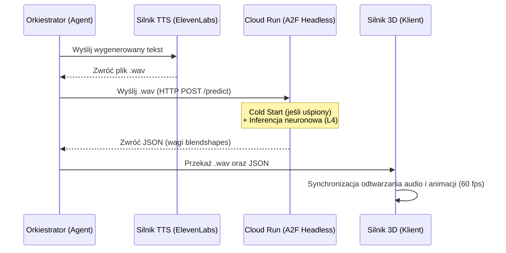

# 7. Alternatywa: Neural Audio-to-Face — NVIDIA Audio2Face na Google Cloud Run (Serverless GPU)

> **Status:** research / alternatywa dla obecnego lip-syncu wizemowego (docs/3).
> **Cel:** realistyczna mikromimika reagująca na głos i emocje zamiast sztywnego mapowania wizemów.
> **Kont tekst:** obecny system (docs/1–6) animuje usta z alignmentu znaków ElevenLabs + warstwy G2P + Edytora Wizemów. Poniższy dokument opisuje, jak podmienić warstwę mimiki na **neuronowy NVIDIA Audio2Face (A2F)** wdrożony kosztowo-efektywnie na **Google Cloud Run z akceleratorami L4**.

## 1. Uzasadnienie architektoniczne

Obecny system wizemów, choć lekki, ma ograniczenia w zakresie realizmu, mikromimiki i reakcji na ładunek emocjonalny głosu. Zastąpienie go architekturą **Neural Audio-to-Face** eliminuje te problemy.

Wybór **Google Cloud Run z GPU (Scale-to-Zero)** pozwala na:

- **Optymalizację kosztów** — aplikacja działa i generuje koszty (ok. $0.67/h pracy akceleratora L4) wyłącznie w momencie faktycznej inferencji na pliku audio;
- **bezobsługowość** — brak konieczności zarządzania maszynami wirtualnymi (Compute Engine);
- **łatwość integracji** — zapakowanie A2F w kontener (NVIDIA NIM / headless) pozwala osadzić ten krok jako pojedyncze narzędzie (tool) w szerszych, wieloagentowych środowiskach deweloperskich.

## 2. Architektura potoku (pipeline)

Rozwiązanie opiera się na mikroserwisach. Całość może być zarządzana przez główny proces orkiestratora (np. sub-agenta), który zarządza asynchronicznymi wywołaniami.

### Komponenty

1. **Mózg (Agent LLM)** — generuje tekst odpowiedzi oraz tagi emocjonalne/kontekstowe.
2. **Głos (Silnik TTS)** — np. ElevenLabs API; przetwarza tekst na plik `.wav` (PCM, 16–44.1 kHz).
3. **Serwer mimiki (Cloud Run + L4)** — skonteneryzowana instancja Audio2Face w trybie headless (obrazy z NVIDIA NGC). Odbiera `.wav` przez REST, wykonuje inferencję i zwraca JSON z wagami 52 blendshape'ów ARKit per klatka.
4. **Klient (silnik 3D / UI)** — aplikacja końcowa; pobiera audio + JSON i synchronicznie odtwarza dźwięk z animacją (Unreal / Unity / **WebGL — nasz przypadek**).

## 3. Diagram przepływu (sequence)



## 4. Wyzwania wdrożeniowe i mitygacja

### A. Cold starts (zimny start kontenera)

Największe wyzwanie Cloud Run — czas wybudzania. Obrazy Docker z modelami NVIDIA potrafią ważyć kilka–kilkanaście GB; pierwsze zapytanie do uśpionego serwera może zająć kilkadziesiąt sekund.

- **Mitygacja:** asynchroniczne mechanizmy na froncie (animacje oczekiwania, buforowanie odpowiedzi); ewentualnie `min instances = 1` w godzinach szczytu.

### B. Ograniczenia czasowe Cloud Run

Pojedyncze żądanie ma maksymalny timeout (do ~60 min). Przy krótkich klipach (odpowiedzi asystenta) to nie problem — inferencja krótkiego pliku na L4 to ułamek sekundy.

### C. Lokalne środowisko testowe

Zanim kontener trafi na chmurę, pipeline powinien być testowany lokalnie z akceleratorem (np. RTX 3090, 24 GB VRAM) — idealne środowisko do prototypowania przepływu gRPC/REST do skonteneryzowanego A2F przed deploymentem do GCP (oszczędność + krótka pętla sprzężenia zwrotnego).

## 5. Struktura danych — odpowiedź A2F (JSON)

Odpowiedź parsujemy na klatki (frames) i aplikujemy na nasz rig ARKit (istniejący `ArKitBlendshapeDriver` z docs/1):

```json
{
  "fps": 60,
  "frames": [
    {
      "frame_time": 0.016,
      "blendshapes": {
        "JawOpen": 0.12,
        "MouthSmileLeft": 0.05,
        "EyeBlinkRight": 0.0
      }
    }
  ]
}
```

> Uwaga integracyjna: u nas nazwy morphów są znormalizowane (np. `jawOpen`, `mouthSmileLeft`). Uwaga: `normalizeShapeName` (`src/avatar/shape-normalizer.ts`) obsługuje warianty lowercase/underscore — **sam nie składa nazw PascalCase** (`MouthSmileLeft` zwróci bez zmian), dlatego parser odpowiedzi A2F ma własny dekapitalizer (patrz niżej).

> Uwaga integracyjna v2 (kontrakt klienta, Faza 8): klient odtwarza ramki trybem `frames`
> FaceControllera (`feedFrames`). Kontrakt wewnętrzny: `PoseFrame.timeSec` jest **względny**
> (baza = `startSec` z `AudioEngine.playChunk`, dodawana JEDNORAZOWO w `feedFrames`), a
> `FramesClip` niesie metadane `shapes` (kształty, którymi strumień włada), `carriesEyes`
> i `carriesEmotion`. Wrapper REST jest właścicielem powyższego formatu JSON (konwertuje
> natywne wyjście A2F/SDK na ten kontrakt). Nazwy ARKit PascalCase (`MouthSmileLeft`) są
> sprowadzane do camelCase **dekapitalizerem parsera** (`src/lipsync/a2f-parser.ts`) — sam
> `normalizeShapeName` nie składa PascalCase (~30/52 nazw L/R).

## 6. Kolejne kroki deweloperskie

1. Pobranie headless obrazu Audio2Face z rejestru NVIDIA NGC.
2. Warstwa API w Pythonie (np. FastAPI) opakowująca wejście/wyjście silnika.
3. Testy lokalne przepływu danych (audio → JSON → klient WebGL).
4. Budowa obrazu z zależnościami i wdrożenie na GCP Cloud Run (flaga akceleracji GPU L4).
